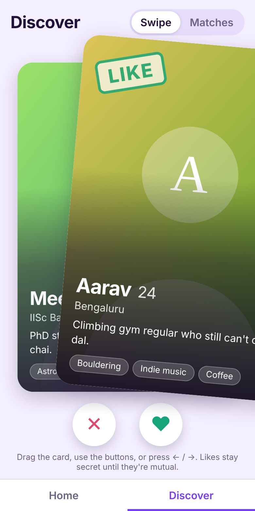
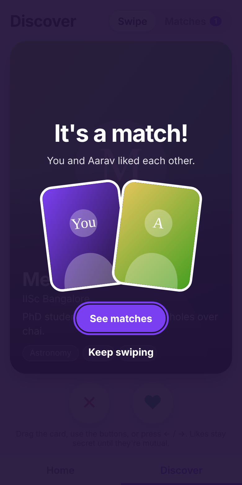
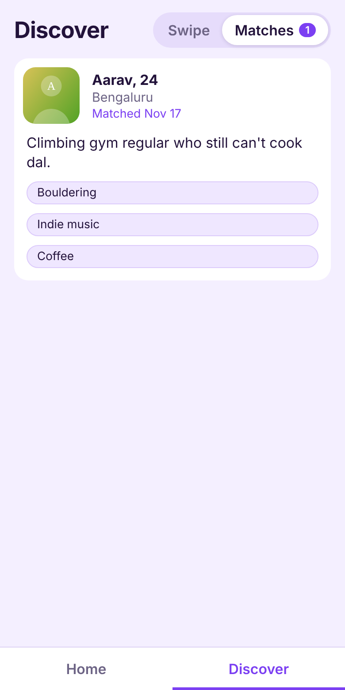
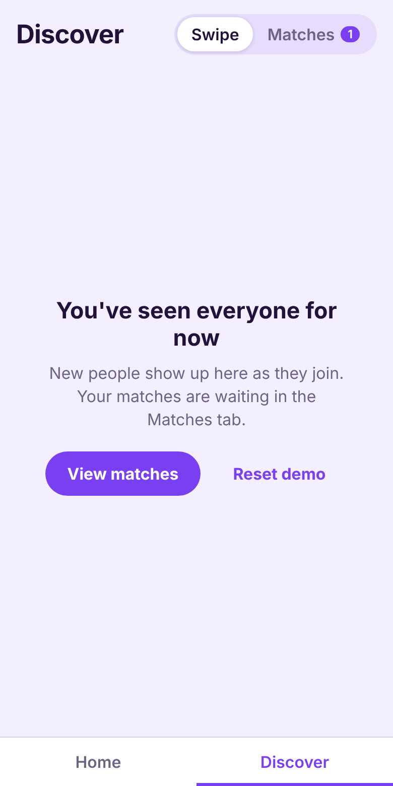

# Coy Discover

A swipe-based **Discover** tab for Coy: swipe right to like, left to pass, and a match happens **only when both people liked each other**. Nobody ever learns who liked them unless it's mutual, which is Coy's core promise.

Built as a standalone Next.js 14 app (App Router, API routes, JSON-file persistence). The **Home** tab is intentionally blank.

**Live demo:** _add your Vercel link here_  ·  **Part A write-up:** [PART_A.md](./PART_A.md)

<p>
  
  
  
  
</p>

## Run

```bash
npm install
npm run dev     # http://localhost:3000 — open DevTools mobile view for drag gestures
npm test        # 9 unit tests on the matching/privacy logic
python3 scripts/e2e.py   # optional: real-browser test (needs `pip install playwright`, server running; set BASE_URL)
npm run build
```

## Tested in a real browser
`scripts/e2e.py` drives mobile Chromium with actual pointer drags: a short drag snaps back, a long drag swipes, a match shows the overlay, swipes survive a reload, keyboard and buttons work, no profile ever repeats while swiping through all 32, and the console stays error-free.

## Try it (demo script)
1. Swipe right on **Aarav** (first card): "It's a match!" 
2. Swipe right on **Kabir**: nothing visibly different from a pass. That's the point.
3. Open **Matches**, reload the page: everything persists.
4. Swipe through everyone to see the empty state; **Reset demo** restarts.

32 profiles are seeded; 11 have already liked you (ids in `lib/seed.js`).

## API
| Route | Description |
|---|---|
| `GET /api/feed` | Profiles not yet swiped on |
| `POST /api/swipe` `{profileId, direction: "like"\|"pass"}` | Records the swipe → `{match, profile?}` |
| `GET /api/matches` | Mutual matches, newest first |
| `POST /api/reset` | Demo helper: wipes swipes and matches |

Invalid input returns `400`, unknown profile `404`.

## Architecture
```
app/api/*          thin route handlers (HTTP only)
lib/service.js     pure business logic: feed, swipe, matches  ← all privacy rules live here, unit-tested
lib/db.js          JSON persistence: atomic writes + serialised read-modify-write
lib/seed.js        32 mock profiles
components/        Discover (state, API calls), SwipeCard (gesture + animation)
tests/             node:test suite, no extra dependencies
```

## Design decisions (and why)
- **The privacy promise is enforced on the server, not the UI.** `likesMe` is stripped by `toPublic()` before any response leaves. A like on someone who didn't like you returns the exact same body as a pass, so even inspecting network responses reveals nothing. Tests assert this.
- **Feed order is independent of who liked you.** If likers surfaced first, a user could infer who liked them by position. (In this seed, likers are spread across the list, and Aarav is first purely so the demo works fast.)
- **A swiped profile never returns.** The feed filters on the persisted swipe map, and `/swipe` is idempotent (first swipe wins), so a replayed or double-tapped request can't turn a pass into a like. There is deliberately no "undo", since it would contradict this requirement.
- **No lost updates.** Read-modify-write is serialised and files are written atomically (tmp + rename). I fired 20 concurrent swipes at the server to verify nothing was dropped.
- **Optimistic UI, honest failures.** The card leaves immediately; if the save fails the user sees an error with a retry, and the profile stays in the queue.
- **Gestures:** pointer events (one code path for touch and mouse), rotation tied to drag distance, LIKE/PASS stamps that fade in, fly-off past a 110px threshold, snap-back below it. Also buttons, ←/→ keys, focus management on the match dialog, Escape to dismiss, and `prefers-reduced-motion` respected.

## Trade-offs and what I'd do next
- **JSON file → real DB.** Fine for a single-user assignment. On Vercel it falls back to `/tmp` (ephemeral), so use a VM or swap `lib/db.js` for SQLite/Postgres for real persistence.
- **Single user, no auth** as specified. In production, `swipes`/`matches` would be keyed by `userId`, and a match would be computed from a `likes(from, to)` table: `like` creates a row, and a match is a row in each direction.
- **Timing side channels.** At scale, a match involves an extra write; I'd pad or randomise latency so response time can't leak mutual-ness before the UI reveals it.
- **Next:** pagination/cursor for `/feed`, rate limiting on `/swipe`, moving the Playwright check into CI, real image upload + CDN.
